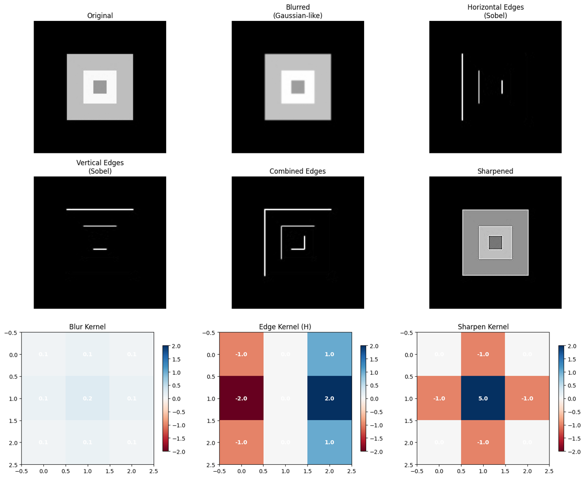
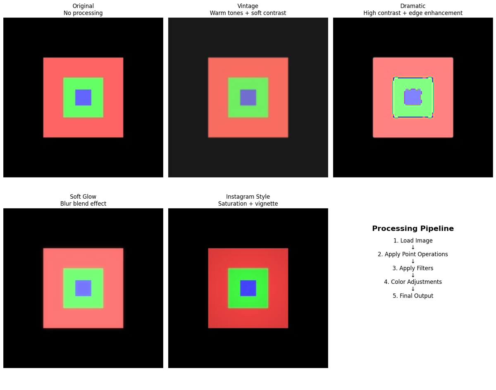
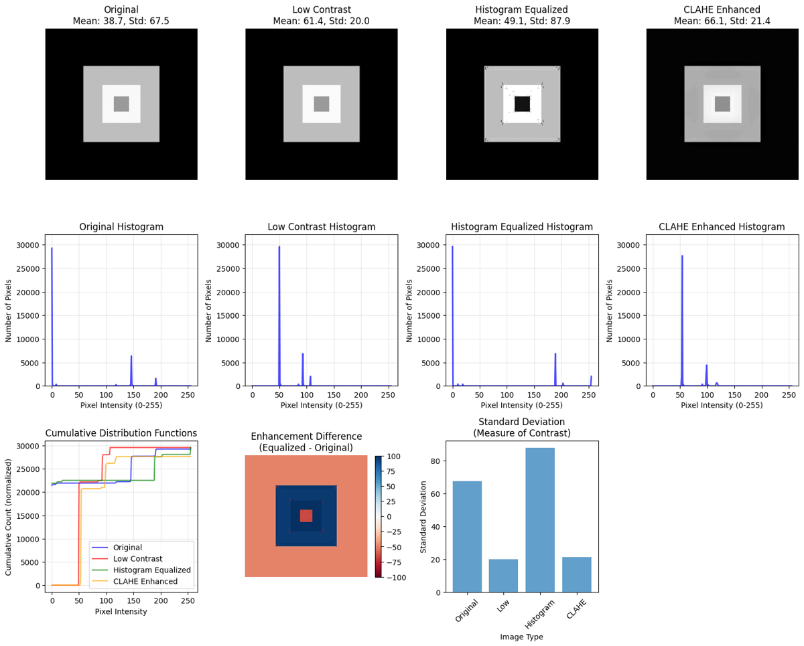

# Lab 02 – Image Processing Fundamentals
**From Pixels to Perception** · ITAI 1378 Computer Vision

## What this lab is about
How a computer "sees" an image: as a grid of numbers. The lab builds the classic image-processing operations step by step, the same building blocks that modern AI vision models are made of.

**Tools:** Python · OpenCV · Pillow · NumPy · Matplotlib

## What the experiment does
| Part | What I did |
|---|---|
| 1. Images as matrices | Loaded a test image and checked its shape, data type, and value range; split it into Red, Green and Blue channels; converted it to grayscale two ways (OpenCV weighted vs. simple average) |
| 2. Point & neighborhood operations | Wrote brightness and contrast functions from scratch; applied convolution kernels for **blur, edge detection, and sharpening** |
| 3. Advanced processing | Histogram analysis, **histogram equalization and CLAHE**; geometric transforms: scaling, 30° rotation, translation, shear |
| 4. Creative pipeline | Combined operations into filters: **Vintage, Dramatic, Soft Glow, Instagram-style** (saturation + vignette) |
| 5. AI connection | Simulated a style-transfer idea with edges, texture filters and "learned" filters, showing how convolution leads to CNNs |

## Key results
- The test image is a **200 × 200 × 3** matrix of `uint8` values from 0 to 255 (120,000 bytes).
- Grayscale turns it into a **200 × 200** matrix, cutting memory from **120,000 → 40,000 bytes** (one third).
- Small 3 × 3 kernels are enough to blur, sharpen, or find edges, the same idea a CNN learns automatically.

## Notebook
[`L02_Saeed_Sadia_ITAI1378.ipynb`](L02_Saeed_Sadia_ITAI1378.ipynb) · runs in Google Colab, all outputs saved.
