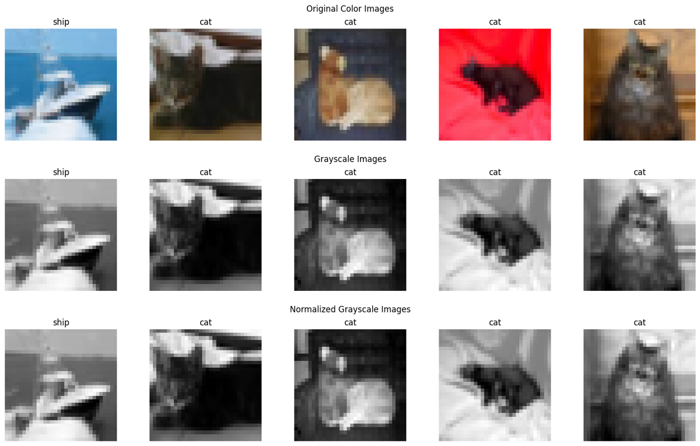

# Lab 03 – Image Classification with SVM (Option B)
**Classic machine learning on real images** · ITAI 1378 Computer Vision

## What this lab is about
Before deep learning, images were classified with traditional machine learning. This lab builds a complete image classifier with a **Support Vector Machine (SVM)** on the CIFAR-10 dataset.

**Tools:** Python · scikit-learn (SVC) · TensorFlow/Keras (dataset) · NumPy · Matplotlib

## What the experiment does
1. Loaded **CIFAR-10** and chose **3 classes: cat, dog, ship**.
2. Preprocessed each image: color → **grayscale** → **normalized** (÷255) → **flattened** into 1,024 numbers.
3. Trained an **SVM with a linear kernel** on **15,000** images and tested it on **3,000** (1,000 per class).
4. Evaluated with accuracy, precision, recall and F1.

## Key results
| Class | Precision | Recall | F1 |
|---|---|---|---|
| cat | 0.48 | 0.48 | 0.48 |
| dog | 0.49 | 0.48 | 0.49 |
| ship | 0.66 | 0.68 | 0.67 |
| **Accuracy** | | | **54.7%** |

- Well above random guessing (about 33% for 3 classes).
- **Ships are easiest**: clear shapes on water backgrounds.
- **Cats and dogs get confused**: raw grayscale pixels can't capture what makes them different, which is why CNNs are the next step.

## Notebook
[`L03_B_SadiaSaeed_ITAI_1378.ipynb`](L03_B_SadiaSaeed_ITAI_1378.ipynb) · runs in Google Colab, all outputs saved.
