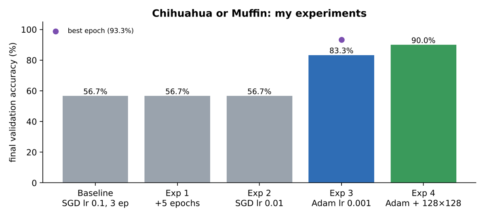
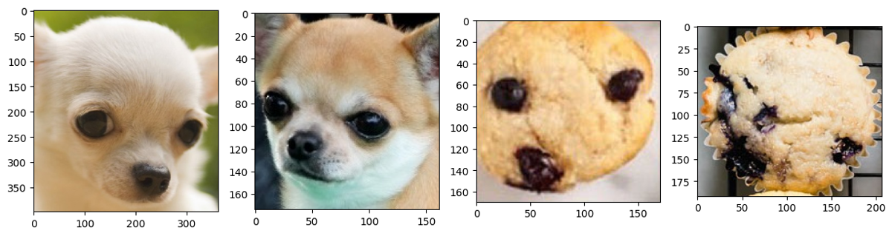
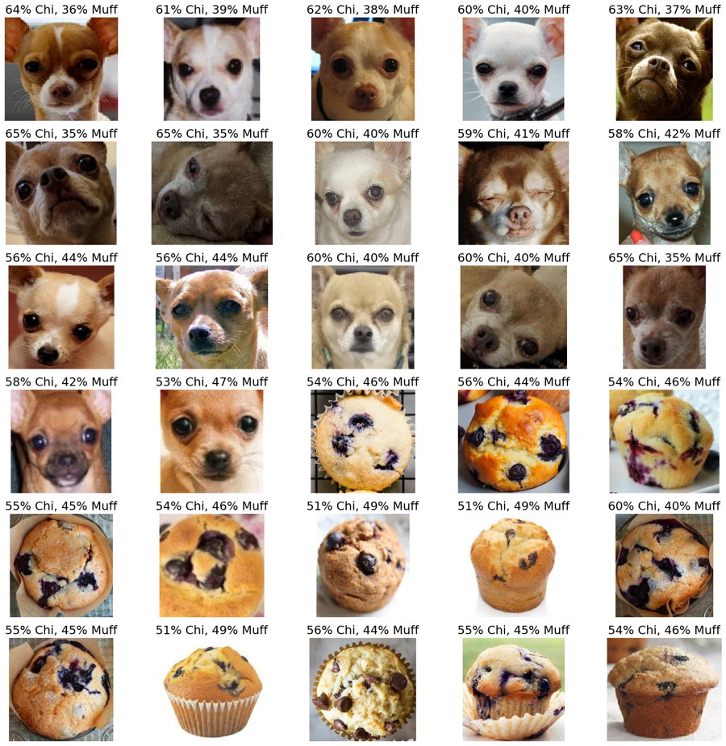

# Lab 04 – Chihuahua or Muffin? (Neural Network)
**My first deep learning image classifier** · ITAI 1378 Computer Vision

## What this lab is about
A famous internet puzzle: chihuahua faces and blueberry muffins look surprisingly alike. This workshop builds a **neural network in PyTorch** that tells them apart.

**Tools:** Python · PyTorch · torchvision · Matplotlib · Data: [workshop-chihuahua-vs-muffin](https://github.com/patitimoner/workshop-chihuahua-vs-muffin) (120 training / 30 validation images)

## What the experiment does
- Built a fully connected network **12,288 → 128 → 64 → 32 → 2** on 64 × 64 images, trained with cross-entropy loss.
- Ran a baseline (SGD, learning rate 0.1, 3 epochs), then **4 experiments of my own** to improve validation accuracy.

## Key results
| Run | What I changed | Validation accuracy |
|---|---|---|
| Baseline | SGD, lr 0.1, 3 epochs | 56.7% |
| Experiment 1 | 5 more epochs | 56.7% |
| Experiment 2 | Smaller learning rate (0.01) | 56.7% |
| **Experiment 3** | **Adam optimizer** (lr 0.001), fresh model | **83.3%** (best epoch **93.3%**) |
| **Experiment 4** | **Adam + bigger images (128 × 128)** | **90.0%** (most stable) |

**What I learned:** the **optimizer** made the biggest difference. Adam lifted accuracy from 56.7% to 90%, while training longer with SGD did not help. Bigger images made the final result steadier.

## Notebook
[`L04_SadiaSaeed_ITAI_1378.ipynb`](L04_SadiaSaeed_ITAI_1378.ipynb) · runs in Google Colab, all outputs saved.
