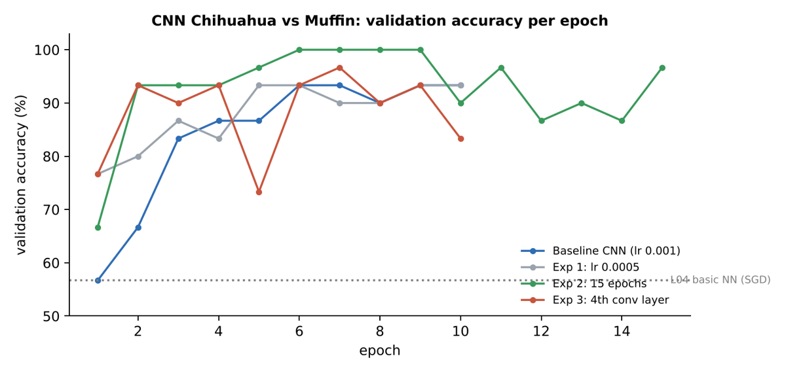
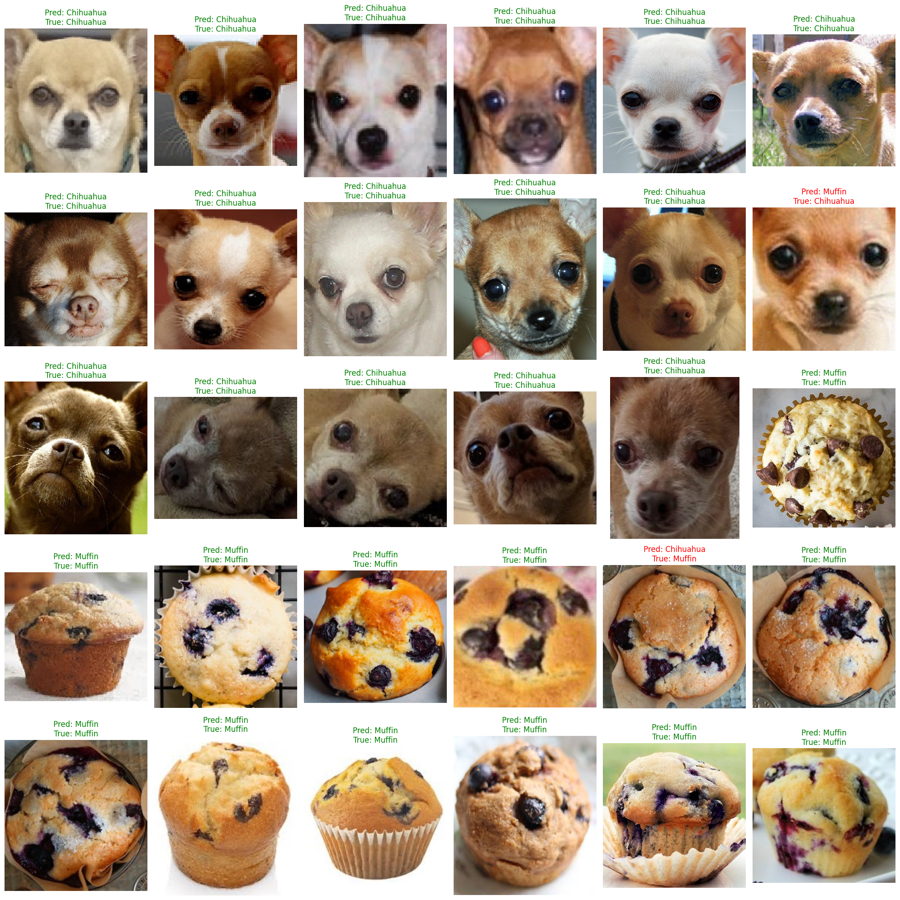

# Lab 05 – Chihuahua or Muffin? (Convolutional Neural Network)
**Same problem, a better tool** · ITAI 1378 Computer Vision

## What this lab is about
Lab 04 used a basic neural network. This lab solves the same chihuahua-vs-muffin problem with a **Convolutional Neural Network (CNN)**, which learns edges, textures, and shapes directly from the image.

**Tools:** Python · PyTorch · torchvision · Matplotlib · same dataset as Lab 04 (120 training / 30 validation images)

## What the experiment does
- **CNN:** 3 convolution blocks (32 → 64 → 128 filters, ReLU, max pooling), then a 512-neuron layer with dropout 0.5.
- **Training:** Adam (lr 0.001), 10 epochs, data augmentation with random flips and small rotations.
- Ran **3 experiments of my own**: learning rate, number of epochs, and network depth.

## Key results
| Run | What I changed | Final validation accuracy | Best epoch |
|---|---|---|---|
| **Baseline CNN** | — | **93.3%** | 93.3% |
| Experiment 1 | Learning rate 0.0005 | 93.3% | 93.3% (learned faster early on) |
| **Experiment 2** | 15 epochs | **96.7%** | **100%** |
| Experiment 3 | Added a 4th conv layer (256 filters) | 83.3% | 96.7% |

**What I learned**
- **CNN vs. basic network:** 93.3% vs. 56.7% on the same data. Convolutions understand images much better.
- Training longer reached **100%** for a few epochs, then wobbled, an early sign of **overfitting** on a small dataset.
- A deeper network is not always better: with only 120 images, the extra layer was less stable.

## Notebook
[`L05_CNN_SadiaSaeed_ITAI_1378.ipynb`](L05_CNN_SadiaSaeed_ITAI_1378.ipynb) · runs in Google Colab, all outputs saved.
