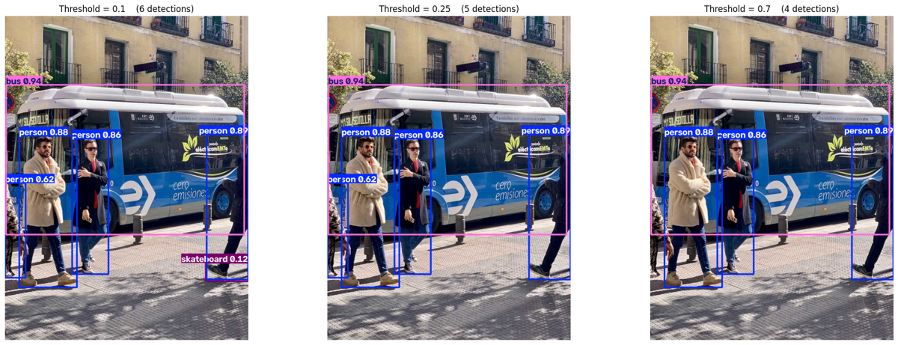
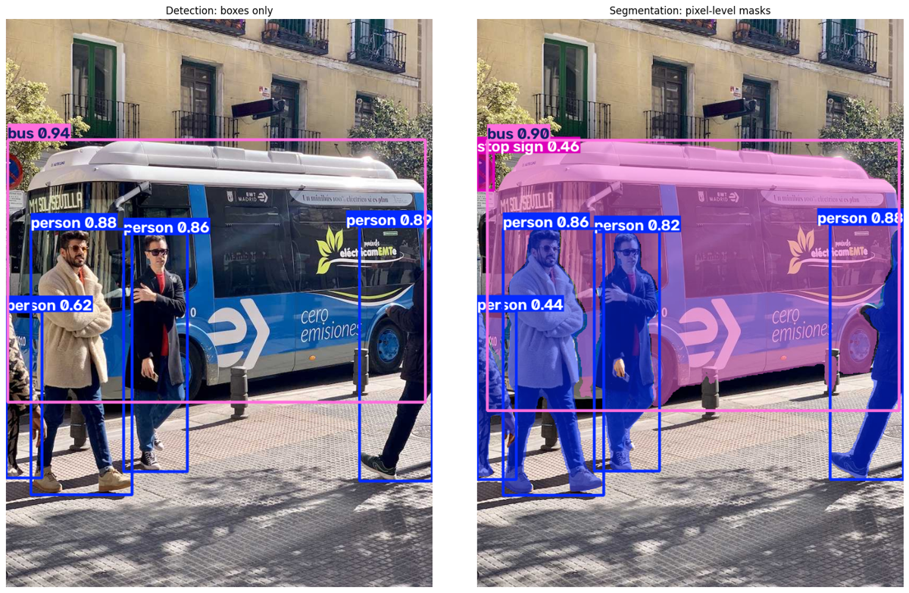
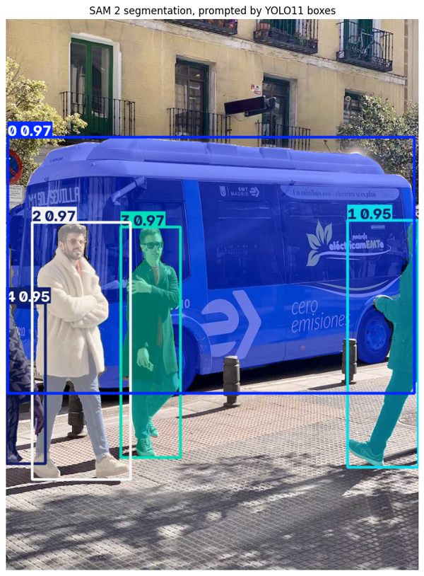

# Lab 06 – Object Detection and Image Segmentation
**Finding and outlining objects** · ITAI 1378 Computer Vision

## What this lab is about
Classification says *what* is in an image. **Detection** also says *where* (bounding boxes), and **segmentation** outlines the *exact pixels* of each object. This lab uses today's standard tools for both.

**Tools:** Python · Ultralytics · **YOLO11** (detection) · **YOLO11-seg** (instance segmentation) · Meta **SAM 2** (foundation model) · Matplotlib

## What the experiment does
| Part | What I did | Result |
|---|---|---|
| Object detection | YOLO11 nano on a street photo | **5 objects**: bus 94%, people 89%, 88%, 86%, 62% |
| My own image | YOLO11 on a soccer photo | 2 people (84%, 78%) + a "tie" (45%), likely a mistake |
| Confidence threshold | Same photo at 0.10 / 0.25 / 0.70 | **6 → 5 → 4 detections**: low thresholds add false objects (a "skateboard" at 12%), high thresholds drop real ones (the 62% person) |
| Instance segmentation | YOLO11-seg | **6 pixel masks** (4 people, bus, stop sign) |
| Detect-then-segment | YOLO boxes used as prompts for SAM 2 | Precise masks. SAM 2 outlines objects but does not name them, so YOLO provides the labels |
| Evaluation | IoU visualization, precision and recall | Explained with examples |

## What I learned
- The **confidence threshold** is a trade-off: a safety system wants a low threshold (catch everything), a photo tagger wants a high one (avoid wrong labels).
- **Specialist vs. foundation model:** YOLO knows 80 everyday classes and labels them. SAM 2 can segment anything, but needs another model for names.
- This lab is where my final project began: **PetGuard AI** uses YOLO to detect pets entering restricted areas.

## Notebook
[`L06_Saeed_Sadia_ITAI1378.ipynb`](L06_Saeed_Sadia_ITAI1378.ipynb) · runs in Google Colab, all outputs and reflection answers saved.
