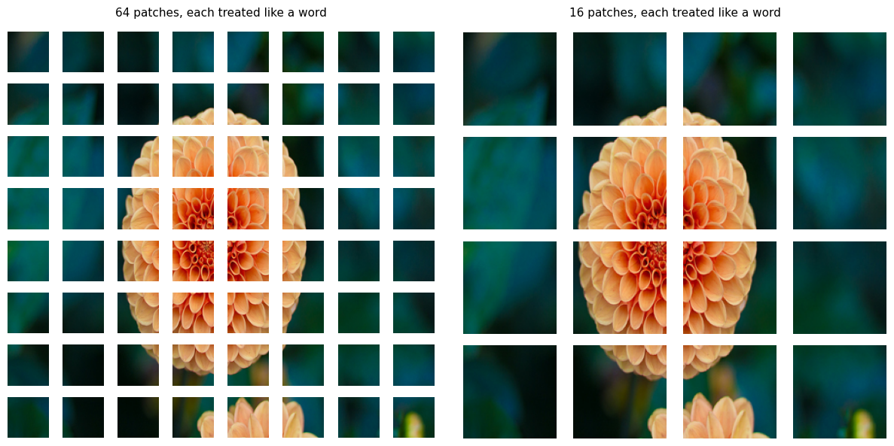
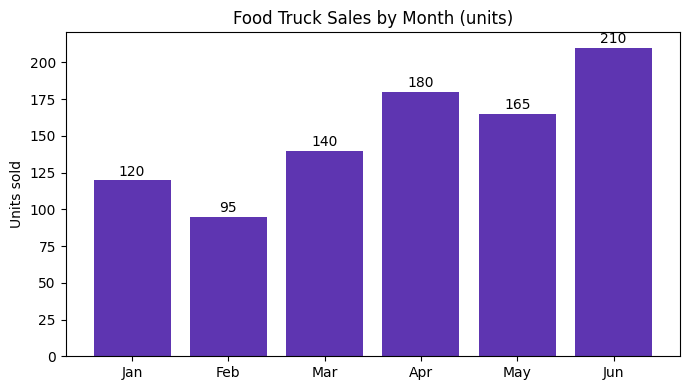

# Lab 08 – Vision Transformers and VLMs
**Talking to your images** · ITAI 1378 Computer Vision

## What this lab is about
**Vision Transformers** read an image as a sequence of small patches, the way a language model reads words. **Vision Language Models (VLMs)** add a language model on top, so you can ask an image questions in plain English. One model can classify, count, describe, and read charts just by changing the prompt.

**Tools:** Python · Hugging Face Transformers · **SmolVLM-500M-Instruct** · PyTorch · Google Colab (T4 GPU)

## What the experiment does
| Part | What I did | Result |
|---|---|---|
| ViT patches | Sliced my own image (384 × 384) into patches of **48 px (64 patches)** and **96 px (16 patches)** | Smaller patches = more detail, more computation |
| Interview an image | 3 questions of increasing difficulty | Facts and colors answered well; the reasoning question was the weakest |
| One model, many jobs | Same model as a **classifier**, **counter**, and **describer** | "Cat." · "1" · "Green background. Cat." |
| Accessibility alt text | Weak vs. professional prompt | The professional prompt gave short, screen-reader-friendly descriptions |
| Chart reading | Bar chart with known values (ground truth) | **2 of 3 correct**: right on the highest month and March's value, wrong on whether sales went up or down |
| Hallucination hunt | My own trick questions | On the cat photo it correctly said "there is no car". On the chart it **played along** and invented a "blue" car |
| Deployment audit | Education scenario: 2 charts with known answers, same question asked 3 ways | **Consistent 3/3** ("English" = lowest score). Verdict: useful, but needs a **human in the loop** because of hallucination risk |

## What I learned
- The **prompt is the task**: constrained prompts ("answer with one word / just a number") make VLM output usable in software.
- Always test with **ground truth**. Without known answers, you can't tell a correct answer from a confident hallucination.
- Small open models can run on free hardware, but they still make mistakes that need checking.

## Notebook
[`L08_Saeed_Sadia_ITAI1378.ipynb`](L08_Saeed_Sadia_ITAI1378.ipynb) · runs in Google Colab, all outputs and reflection answers saved.
